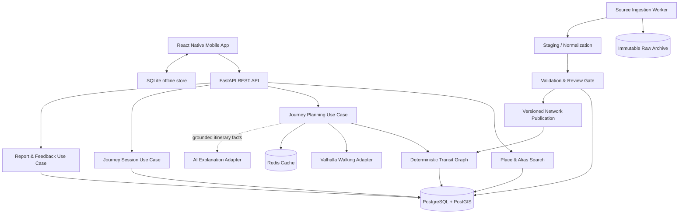
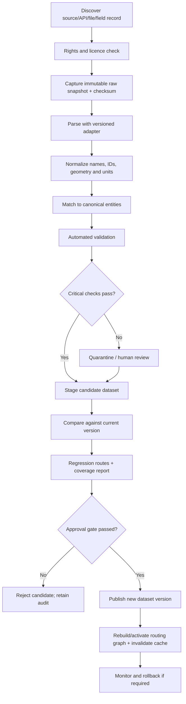

# Sri Lanka Journey Planner — Complete Implementation Plan

**Document ID:** 11  
**Status:** Proposed execution baseline — approval required before Phase 0 implementation  
**Version:** 1.0  
**Date:** 2026-11-19  
**Audience:** Product owner, coding agents, mobile/backend/data engineers, QA and future contributors  
**Purpose:** This is the execution plan and engineering control document for building the Sri Lankan multimodal journey-planning application. It is intended to be committed into the repository and used as persistent development knowledge by AI coding agents.

> **Product promise:** A Sri Lankan multimodal journey planner that discovers all practical ways to reach a destination and converts each route into a clear, detailed, step-by-step travel instruction that anyone can follow.

---

## 0. How the coding agent must use this document

This document supplements, and does not replace, the product and architecture documents listed below. Before changing code, the coding agent must:

1. Read this file and the relevant existing product/technical documents.
2. Inspect the actual repository, current branch, working tree, package manifests, existing tests and current implementation. Never assume the repository is empty or that a planned component already exists.
3. Identify the current phase, the exact phase tasks being requested, dependencies, and acceptance criteria.
4. Produce a short implementation plan for the requested task, including files likely to change and tests to run.
5. Implement only the approved scope. Do not silently expand the phase or introduce a new architecture.
6. Run the required checks and report the actual commands and outcomes. Never claim a test passed unless it was run and passed.
7. Update relevant documentation, decision records and phase status after implementation.
8. Stop and report blockers when source data, legal rights, product decisions or technical assumptions are insufficient. Do not fabricate transport facts to make a demo appear complete.

### 0.1 Required companion documents

The following files form the project knowledge base and should remain together in the repository's `docs/product/` or equivalent documentation directory:

- `00_DOCUMENTATION_INDEX_AND_PRODUCT_VISION.md`
- `01_TRAVELLER_PROBLEMS.md`
- `02_PROBLEM_GAP_ANALYSIS.md`
- `03_PRODUCT_FEATURES_AND_EXPERIENCE.md`
- `04_SRI_LANKA_SPECIFIC_FEATURES.md`
- `05_USER_STORIES_AND_FLOWS.md`
- `06_TECHNICAL_ARCHITECTURE.md`
- `07_DATA_SOURCES_AND_ACQUISITION.md`
- `08_SCOPE_ROADMAP_AND_RISKS.md`
- `09_RESEARCH_REFERENCES_AND_VALIDATION.md`
- `11_IMPLEMENTATION_PLAN.md` (this document)

If file names or content differ in the repository, inspect and reconcile them; do not overwrite newer approved decisions merely to match this list.

### 0.2 Conflict resolution and decision precedence

Use this precedence when documents conflict:

1. Explicit, latest product-owner decision recorded in an Architecture Decision Record (ADR).
2. Approved technical architecture and data strategy.
3. This implementation plan.
4. Product feature and user-story documents.
5. Earlier research drafts and assumptions.

The coding agent must flag a conflict rather than choose silently. Proposed changes to core architecture require an ADR explaining the problem, options, consequences, migration impact and approval status.

---

## 1. Implementation readiness and confidence

### 1.1 Are we ready to start?

**Yes — we are ready to start controlled Phase 0 engineering and repository setup. We are not yet ready to claim that the complete product requirements and transport data are implementation-ready for a nationwide launch.** The product direction and broad architecture are sufficiently clear to begin building the foundation. The largest remaining risks are data rights, pilot coverage, source quality, route-variant correctness, field verification, map/geocoding provider terms and several operational decisions.

Do not delay all engineering until every future feature is decided. Instead, resolve high-impact uncertainties before the phase that depends on them.

### 1.2 Confidence by area

| Area | Readiness | What this means |
|---|---|---|
| Product promise and core UX | High | Build around complete, actionable, leg-by-leg instructions. |
| MVP scope boundaries | High | Static network planning; no timetable/live-service guarantee. |
| Backend and data foundation | High | FastAPI, PostgreSQL/PostGIS, Redis and versioned ingestion are a sound baseline. |
| Mobile framework | High, selected baseline | React Native + TypeScript + Expo. Validate native requirements early. |
| Map renderer | Medium-high, selected baseline | MapLibre; final tile/style provider and terms remain to be chosen. |
| Multimodal routing | Medium | Build a deterministic graph-based planner; validate algorithm on real pilot data. |
| Walking routing | Medium-high | Valhalla is the baseline candidate; test Sri Lankan pedestrian coverage and deployment. |
| Transport source coverage and rights | Low-medium | Must be audited and legally reviewed before publishing imported data. |
| AI assistance | High for bounded use | AI explains/translates grounded itinerary facts; it does not invent or determine routes. |
| Nationwide completeness | Not ready | No nationwide completeness claim until measured and verified. |

### 1.3 Decisions that must be resolved before dependent work

| Decision | Required by | Default execution rule until resolved |
|---|---|---|
| Initial pilot corridor(s) and destination set | Phase 1 data ingestion | Do not hard-code a geographic boundary; create a configurable pilot dataset and choose the pilot after coverage audit. |
| OSM/NSDI/NTC/GTFS reuse rights | Before importing/publishing each source | Keep sources separated and private in development until rights/attribution are recorded. Public access is not permission to redistribute. |
| Map tile/style provider and caching policy | Phase 2 mobile map | Use MapLibre renderer behind a provider abstraction; do not assume MapLibre supplies map data or tiles. |
| Geocoding/search provider | Phase 2 search | Use a provider abstraction and curated local aliases; do not rely on public Nominatim as an unrestricted production service. |
| Valhalla vs another pedestrian router | Phase 1/2 integration | Prototype Valhalla on pilot OSM extract and compare path quality; do not bind domain logic to its API. |
| Authentication and account scope | Before saved/synced journeys | Anonymous core planning. Defer accounts unless sync or user-owned features require them. |
| Hosting region, cloud and budget | Before staging deployment | Keep deployment configuration portable; do not hard-code a cloud vendor. |
| Sinhala/Tamil translation review process | Before public pilot | Machine translation is not accepted as final critical travel wording; obtain native review. |
| Fare scope | Before fare feature | Exclude fare ranking unless the source, effective date and calculation are reliable. |
| Field verification capacity and moderation owner | Before public pilot/contributions | No user-submitted critical correction is auto-published. |

### 1.4 Readiness gate

Phase 0 can start immediately. Phase 1 ingestion may use sample or legally cleared development data. Public pilot release must not proceed until the project has: (a) a selected pilot area, (b) source-rights register, (c) verified critical route/stop/transfer records, (d) an agreed disclaimer for static service data, (e) native-reviewed critical language strings, and (f) a tested reporting/rollback process.

---

## 2. Product scope for the first release

### 2.1 MVP outcome

A user can enter an origin and destination, select travel preferences, receive several practical network-based route alternatives, understand the trade-offs, open one itinerary and follow it through each walking, bus and validated railway leg. The instructions identify where to walk, where to board, which route and direction to take, where to alight, how to transfer and how to reach the final destination entrance when that information is verified.

### 2.2 MVP features (P0)

1. Origin/destination search, autocomplete, manual map pin and optional current location.
2. Sinhala, Tamil and English name/alias support, including transliteration and locality disambiguation.
3. Walking access and egress using a pedestrian network, not straight-line distance.
4. Bus route planning on validated pilot corridors; railway only where station order and line data are validated.
5. Distinct route variants, directions, endpoints and short/partial service patterns.
6. Explicit transfer connections and walk paths between stops, stands, terminals and stations.
7. Several practical alternatives with walking, transfers, modes, estimated duration and confidence/caveats.
8. Deterministic structured instructions for each itinerary leg and step.
9. Journey overview map and active journey mode with manual progress confirmation.
10. Coverage, no-route, ambiguous-data, low-confidence and offline/error states.
11. Basic report-an-issue workflow (may be staged behind a pilot/admin review process).
12. Basic itinerary caching for active trip continuity.
13. Privacy-first planning without mandatory login.
14. Basic accessibility foundations: adjustable text, screen-reader semantics, walking limit, and honest `unknown` access attributes.

### 2.3 Deferred features (do not build in MVP unless explicitly re-approved)

- Exact timetables, next-departure and arrive-by planning.
- Live bus/train GPS, ETA, delay prediction and service alerts.
- Ticketing, payment, reservations or QR validation.
- Nationwide route coverage claims.
- Crowding prediction and comfort scoring without reliable evidence.
- Safety certification, safety heatmaps or guaranteed safe-route claims.
- Fully automated alighting decisions based only on GPS.
- Unmoderated community edits to the canonical transport network.
- AI-generated route numbers, stop names, fares, service availability or factual transfer directions.

### 2.4 Meaning of “all possible routes”

The system must discover **all practical, non-dominated alternatives within configured search limits and available validated data**, not every mathematically possible combination. Exhaustive enumeration can produce huge numbers of near-duplicate or impractical routes. The planner must cap transfers, walking distance, candidate expansion and result count; remove dominated/duplicate options; and disclose coverage limitations.

---

## 3. Agreed technical baseline

The architecture is a **modular monolith with independently testable modules**, not a premature microservice fleet. Keep domain boundaries clean so components can be extracted later if scale justifies it.

### 3.1 Stack

| Layer | Baseline | Responsibility |
|---|---|---|
| Mobile | React Native, TypeScript, Expo | iOS/Android application, journey UI, permissions and local state. |
| Navigation | React Navigation or Expo Router (choose one and record ADR) | Typed navigation and deep links. |
| Maps | MapLibre Native / compatible React Native integration | Render route, stop, transfer and pedestrian geometry. |
| Mobile state/data | TanStack Query + lightweight local state (e.g. Zustand) | Server cache, loading/error states and local UI state. Avoid duplicating server state. |
| Offline local store | SQLite via Expo-compatible library | Selected itineraries, referenced stops/routes, progress and cache metadata. |
| API | Python, FastAPI, Pydantic | REST endpoints, validation, orchestration and OpenAPI contract. |
| Backend architecture | Modular monolith / Clean Architecture boundaries | Domain, application/use cases, adapters and infrastructure. |
| ORM/migrations | SQLAlchemy 2 + Alembic | Persistence and schema migration. |
| Primary DB | PostgreSQL + PostGIS | Canonical transport graph, places, aliases, provenance and geometries. |
| Cache | Redis | Route/search cache, rate limits and transient state; never the only source of truth. |
| Walking router | Valhalla baseline candidate | Pedestrian path computation on a suitable licensed road/path graph. Validate before adoption. |
| Transit planner | Custom deterministic multimodal graph | Route variants, ordered stop sequences, transfer links and constrained candidate generation/ranking. |
| AI | Provider-agnostic LLM adapter; tool-based grounded calls | Explain/simplify/translate itinerary facts, contextual help and report triage only. |
| Raw source archive | S3-compatible object storage or equivalent | Immutable source snapshots, checksums, metadata and parser outputs. |
| Background jobs | Start with a Python worker and Redis-backed queue (choose a maintained library in ADR) | Scheduled source sync, extraction, validation and graph publication. |
| API documentation | OpenAPI generated from FastAPI | Contract for mobile and test clients. |
| Testing | Pytest; mobile unit/component tests; Maestro or Detox for E2E (select one) | Backend, data, routing, UI and journey-level regression. |
| Delivery | Docker, CI pipeline, environment-based config | Reproducible local, test, staging and production environments. |

**Version policy:** pin compatible versions in lockfiles. The coding agent must inspect current ecosystem compatibility before adding packages. Do not blindly copy old package versions from examples.

### 3.2 Logical architecture



### 3.3 Backend module boundaries

- `places`: POIs, destinations, entrances, aliases, geocoding adapter and search.
- `transport`: agencies, routes, variants, stops, ordered stop sequences, stations and service classes.
- `pedestrian`: pedestrian network integration, walk paths and access/egress.
- `transfers`: validated inter-stop/interchange connectors.
- `routing`: candidate generation, multimodal graph search, constraints, Pareto filtering and ranking.
- `itineraries`: normalized journey response, instruction generation and source/confidence summaries.
- `journey_sessions`: start, pause, progress confirmation, completion and local-session semantics.
- `data_ingestion`: source registry, raw snapshots, parsers, normalization, matching and sync runs.
- `data_quality`: validation rules, QA queues, field verification, confidence and publication.
- `reports`: user corrections, moderation and audit trail.
- `ai_assistance`: grounded explanation/translation/help adapter; no route authority.
- `platform`: configuration, logging, metrics, health checks, auth/rate limiting and shared infrastructure.

Do not create one service or one database schema per module. Enforce dependency direction: API → application use cases → domain; infrastructure adapters implement interfaces. Domain code must not depend on FastAPI, SQLAlchemy, Redis, a map vendor or an LLM SDK.

---

## 4. Engineering standards and repository conventions

### 4.1 Suggested repository layout

```text
repo/
  apps/
    mobile/
  backend/
    app/
      api/
      modules/
        places/
        transport/
        pedestrian/
        transfers/
        routing/
        itineraries/
        journey_sessions/
        data_ingestion/
        data_quality/
        reports/
        ai_assistance/
      platform/
    migrations/
    tests/
      unit/
      integration/
      contract/
      routing/
      data_quality/
  data/
    fixtures/
    sample_sources/
    validation_reports/
  infra/
    docker/
    scripts/
  docs/
    product/
    architecture/
    adr/
    runbooks/
  .github/workflows/ or equivalent CI configuration
  README.md
  CONTRIBUTING.md
```

Adapt this to an existing repository rather than restructuring blindly. Do not commit licensed source extracts, secrets, user trip data or large raw datasets unless explicitly permitted and intended.

### 4.2 Code quality requirements

- Type annotations for Python public interfaces; strict TypeScript settings for mobile.
- Pydantic request/response schemas; explicit nullable fields for unknown facts.
- SQL migrations are reviewed and reversible where practical.
- No business rules in route handlers or UI components.
- No raw SQL assembled from user input.
- Use stable internal IDs; never use route number or stop name as a primary key.
- UTC timestamps in storage; explicit local timezone handling for Sri Lanka (`Asia/Colombo`) when displaying dates/times.
- Coordinates use documented WGS84 longitude/latitude order at API boundaries; tests must catch swapped coordinates.
- Store distances in metres and durations in seconds internally; format for display at the client boundary.
- Structured errors with stable error codes; no leaking stack traces to users.
- Secrets via environment/secret manager; never in source control or mobile bundle.
- Log operational metadata, not raw precise journeys or unnecessary location/search content.

### 4.3 Definition of Ready for a coding task

A task is ready when it has a clear user/system outcome, relevant story or requirement ID, scope, dependencies, data contract, acceptance criteria, tests, and known edge cases. If one is missing, the coding agent should ask or propose a documented assumption before implementation.

### 4.4 Definition of Done for every task

- Implementation matches the agreed scope and architecture.
- Tests are added/updated and actually executed.
- Formatting, linting, static checks and type checks pass for changed areas.
- API/schema/docs are updated where relevant.
- No secrets, debug artefacts or fabricated transport data are committed.
- Accessibility, localization, privacy and error states are considered.
- Acceptance criteria are checked explicitly.
- Coding agent provides a truthful change summary, changed-file list, test commands/results, limitations and follow-up items.

---

## 5. Data model and data governance implementation

### 5.1 Core entities

Implement canonical entities and relationships for:

- `source_registry`, `source_artifacts`, `ingestion_runs`, `dataset_versions`.
- `agencies`, `routes`, `route_variants`, `route_variant_validity`.
- `stops`, `stop_aliases`, `route_stop_sequence`, `route_shapes`.
- `rail_lines`, `rail_stations` (or mode-generalized transport entities with clear constraints).
- `pedestrian_nodes`, `pedestrian_edges` or a Valhalla graph reference/version.
- `transfer_connections`, `transfer_path_geometry`.
- `places`, `place_aliases`, `place_entrances`.
- `fare_records` (nullable/disabled until reliable data exists).
- `verification_events`, `data_quality_issues`, `data_reports`, `moderation_events`.

Each imported/derived fact must be traceable to one or more sources. Track source URL or source identifier, licence/rights note, capture timestamp, source publication/effective date where available, parser version, source artifact checksum, verification method/date, confidence and dataset version. Confidence should be fact-level; a stop coordinate can be verified while the route's operational pattern remains unverified.

### 5.2 Source ingestion lifecycle



Rules:

1. Fetching a source does not mean its records are approved for user-facing routing.
2. Every source adapter is idempotent: rerunning the same source version must not create duplicate canonical records.
3. Preserve raw artifacts and parser version for reproducibility.
4. Never overwrite the live dataset in place. Build a candidate version, validate, then publish atomically.
5. Failed or incomplete sync must leave the previous active version available.
6. Material changes to route sequence, stop coordinates, route variants or transfer links require review and regression tests.
7. A rollback restores the previous dataset/graph pointer and invalidates affected caches.
8. Keep a freshness policy per source; do not invent a universal refresh interval. Use source update cadence, rights, rate limits and change frequency.
9. Expose `data_version`, `generated_at`, and relevant freshness/caveat metadata in itinerary responses.
10. Keep third-party and OSM-derived data lineage separable where licence obligations require it.

### 5.3 Initial source strategy

- OSM: candidate for pedestrian graph, stop/POI candidates, route relations and geometry; audit quality and follow ODbL obligations.
- NSDI: candidate official GIS reference layers; confirm per-layer access and reuse rights.
- NTC: route-number, permit, service-class and fare evidence; confirm reuse rights and validate extracted records.
- GTFS: ingest only exact feed versions whose producer, scope, validation results and licence have been checked. A limited feed is not nationwide coverage.
- Sri Lanka Railways: reconcile official station/line information with other sources; do not assume a public complete API exists.
- Field verification: required for critical boarding points, stop side/stand, route variants, transfer connectors and destination entrances.

Do not scrape websites in violation of terms, infer a licence from public availability, or publish an unofficial community dataset without reviewing both its licence and upstream source rights.

---

## 6. Routing and instruction contracts

### 6.1 Planner input contract

At minimum:

- Origin and destination coordinates or canonical place IDs.
- Optional destination entrance ID.
- Allowed modes.
- Maximum access/egress walking distance.
- Maximum transfers and total walking distance.
- User preference weights or ranking profile.
- Optional verified accessibility constraints.
- Active network dataset version (server-selected; client must not choose arbitrary versions).

Departure time is not a routing input for the static MVP except for display/context; do not pretend to perform schedule-aware optimization.

### 6.2 Candidate generation

1. Resolve origin/destination to canonical coordinates and confidence.
2. Snap both ends to the pedestrian network using a bounded search radius.
3. Find candidate boarding/alighting stops within configured walk limits.
4. Find route variants that contain a valid ordered boarding-to-alighting segment.
5. Generate direct and multi-leg candidates through explicit transfer edges.
6. Preserve route direction and variant identity throughout the search.
7. Enforce transfer, walking, mode and confidence constraints.
8. Add access, transfer and final-egress pedestrian legs.
9. Reject candidates with missing critical facts or impossible geometry.
10. Deduplicate and Pareto-filter candidates; return a bounded number of useful alternatives.

### 6.3 Ranking

Use transparent multi-objective ranking across estimated duration, total walking, transfers, verified fare (only if available), route complexity and confidence. A route may be best for one user and not another. Labels such as “fastest estimated”, “least walking” and “fewest transfers” must be computed from the same returned candidate set and criteria. Never label a route “cheapest” when fare is absent/stale or “easiest” without explicit measurable criteria.

### 6.4 Time and fare policy

- Walking time may use documented walking-speed assumptions and path length.
- Ride-time estimates must use a documented model and be labelled estimated; traffic and waiting are not known in the static MVP.
- Present a range or uncertainty label where appropriate; avoid false precision.
- Do not display next departure, guaranteed arrival, transfer availability or service-running-now claims without validated schedule/live data.
- Fare is nullable. Show a fare only when route variant, service type, effective date and source are valid for the journey; otherwise say “fare not verified”.

### 6.5 Itinerary response contract

Every plan response should include:

- `plan_id`, `schema_version`, `network_dataset_version`, `generated_at`.
- `origin`, `destination` and selected entrance if present.
- `alternatives[]` with summary metrics, ranking rationale and caveats.
- `legs[]` in strict order: walk, bus, rail or other supported mode.
- Transit leg: route ID/ref, variant ID, direction/headsign if verified, board stop, alight stop, ordered stop segment and mode.
- Walking leg: start/end, distance, estimated duration, path geometry and instruction facts.
- Transfer leg/connector: from/to stop, connector geometry, distance, path notes and verification.
- `steps[]` with stable IDs, action type, structured facts and localized deterministic text.
- Fact-level confidence, source references, last verified date and unknown fields.
- `limitations[]`, including static-service caveat and low-coverage warnings.

Unknown information must be represented as unknown/null with a reason, not silently omitted if it is critical to a decision.

### 6.6 Human-readable instruction generation

Critical route instructions are deterministic templates populated from validated facts. Examples:

- “Walk approximately 350 m (about 5 minutes) to [verified stop name]. Look for [verified landmark/access point].”
- “Board bus route [route ref] heading toward [verified destination board]. Board at [stop/stand].”
- “Alight at [verified stop]. This is [N] stops after boarding.” Only show stop count if the ordered sequence is reliable.
- “Walk approximately [distance] to [next boarding point] using the mapped connector.”
- “Your final walk is approximately [distance] to [verified entrance].”

If a direction, stop side, destination board, transfer path or entrance is unknown, the instruction must say it is not confirmed. Do not fill the gap with plausible-sounding language.

### 6.7 AI boundary

AI may:

- Rephrase validated instructions in simpler language.
- Translate approved structured facts using reviewed terminology.
- Explain why a route ranks above another using returned metrics.
- Answer contextual questions using the selected itinerary only.
- Classify/triage user reports for human review.

AI may not be the authority for route generation, route number, direction, stop identity, fare, service availability, safety/accessibility guarantees or alighting decisions. AI output must be schema-validated, fact-grounded and have a deterministic fallback. If an AI provider is unavailable, planning and instructions must continue.

---

## 7. Detailed phased implementation roadmap

Phases are sequential gates, but independent work can overlap only when dependencies and acceptance criteria are met. Estimates are deliberately omitted until repository size, team capacity, pilot data and integration complexity are known.

### Phase 0 — Repository audit, product baseline and engineering foundation

**Goal:** Establish a reproducible development environment and ensure the coding agent understands the project before implementing product features.

**Features/work items**

1. Audit repository, branches, working tree, existing modules and deployment state.
2. Add/align project README, docs index, contribution rules and coding-agent instructions (`AGENTS.md` or equivalent).
3. Create ADR template and record baseline architecture decisions.
4. Choose monorepo structure or document existing repository structure.
5. Add environment templates, secret handling, Docker Compose for local PostgreSQL/PostGIS and Redis.
6. Add backend FastAPI skeleton with health/readiness endpoints and OpenAPI.
7. Add mobile React Native/Expo TypeScript skeleton with navigation and environment config.
8. Establish formatting, linting, type checking and test commands.
9. Configure CI for install, lint, type-check, unit tests and build checks.
10. Add structured logging and basic error handling without sensitive journey data.

**Tests and verification**
- Fresh clone can follow documented setup without undocumented manual steps.
- Docker services start; PostGIS extension is enabled; Redis responds.
- API health/readiness endpoints behave correctly.
- Mobile app launches on at least one Android and one iOS simulator/device path supported by the team.
- CI succeeds from a clean branch.
- No secrets are committed; `.env.example` contains placeholders only.
- Existing tests and baseline build are recorded before modifications.

**Exit criteria**
- Repository structure and commands documented.
- Mobile and backend skeletons run locally.
- CI gates pass.
- ADR-001 records the baseline stack and any approved deviations.

### Phase 1 — Canonical transport data foundation and ingestion pipeline

**Goal:** Create an auditable, versioned pilot transport dataset before attempting end-to-end routing.

**Features/work items**

1. Implement source registry, artifact metadata, ingestion run and dataset version models.
2. Implement canonical agencies, routes, route variants, stops, aliases, route-stop sequences and route shapes.
3. Implement transfer connections, places, entrances and fare records as nullable/controlled entities.
4. Add PostGIS geometry types, SRIDs, spatial indexes and validation constraints.
5. Build source adapters in isolation: OSM extract first; then selected NSDI/NTC/GTFS/rail sources only after rights and feasibility review.
6. Archive raw source files with checksum, retrieval time, licence/rights notes and parser version.
7. Normalize route references, stop names, language aliases, coordinates and service patterns.
8. Implement entity matching with explainable candidates; ambiguous matches go to review.
9. Add automated data-quality rules and quarantine invalid records.
10. Build a basic internal QA interface or CLI/report workflow for reviewing routes, stops, variants and transfer connectors.
11. Select pilot corridor(s) from a coverage scorecard; record what is and is not covered.
12. Field-verify critical route variants, stop coordinates, boarding sides/stands, transfer walks and selected destination entrances.
13. Publish an immutable candidate dataset version and activate it only after approval.

**Data validation tests**
- Geometry validity, coordinate bounds and SRID correctness.
- No duplicate canonical IDs; alias collisions surfaced rather than silently merged.
- Route variant has ordered, non-duplicated stop sequence and consistent endpoints.
- Route-stop sequence agrees with source evidence; partial services remain distinct.
- Stops are plausibly related to route shape; outliers flagged.
- Transfer connectors have valid geometry, plausible length and mapped endpoints.
- Source licence/attribution metadata is present for every publishable record.
- Re-running an identical source artifact is idempotent.
- Failed ingestion does not alter active dataset.
- Candidate publication and rollback preserve referential integrity.

**Manual verification**
- Reviewer inspects a sample of every imported source type.
- Field checklist is completed for critical pilot journeys.
- Contradictions between sources are documented and resolved or explicitly marked unknown.

**Exit criteria**
- Pilot corridor and coverage boundary documented.
- Source rights register approved for all published data.
- Versioned dataset with provenance and confidence is active.
- Critical pilot route variants and transfer nodes pass agreed QA.
- Rollback is demonstrated in a non-production environment.

### Phase 2 — Place search, local names and map foundation

**Goal:** Let users reliably identify origin, destination, stops and landmarks on the pilot network.

**Features/work items**
1. Implement place search API and canonical place/stop/station result types.
2. Add alias storage for Sinhala, Tamil, English and transliteration with source/language metadata.
3. Add normalization for common spelling, punctuation, spacing and script variants.
4. Add locality/type disambiguation and ambiguous-result handling.
5. Add search by landmark, junction, institution, stop, station and address where supported.
6. Integrate geocoding behind a provider interface; enforce provider rate and caching terms.
7. Add MapLibre map screen, user-selected pin and map camera state.
8. Display stops, stations, route shapes, POIs and selected origin/destination.
9. Add current-location flow with contextual permission request and manual fallback.
10. Add destination entrance selection for curated pilot POIs.

**Tests and verification**
- Search fixtures cover Sinhala/Tamil/English aliases, transliteration, misspellings and ambiguous names.
- Correct locality/type is shown; ambiguous results are never silently auto-selected.
- Geocoder outage/rate limit falls back to curated search and clear error state.
- Denied location permission does not block manual planning.
- Map coordinates are correct; test catches longitude/latitude reversal.
- Map attribution is visible and tile/provider caching complies with licence.
- Screen reader can identify search fields and result types.

**Exit criteria**
- Pilot places and transport points are searchable in supported languages.
- Users can choose origin/destination manually or via current location/map.
- Map rendering works on supported target devices.

### Phase 3 — Pedestrian routing and transfer graph

**Goal:** Make first-mile, last-mile and transfer walking paths practical and explicit.

**Features/work items**
1. Run a Valhalla proof of concept on the selected pedestrian network and validate Sri Lankan paths.
2. Build a walking-router adapter with a stable internal interface.
3. Implement snapping, bounded fallback and no-path responses.
4. Compute access walk from origin to candidate boarding points.
5. Compute transfer walks between explicit transfer connectors.
6. Compute final egress walk to destination/entrance.
7. Store verified transfer connector overrides where generic routing is insufficient (e.g. terminal access paths).
8. Add walking distance/time estimates and uncertainty metadata.
9. Apply maximum walking preferences and avoid unsupported access claims.
10. Show mapped walking geometry and turn/landmark details only where available.

**Tests and verification**
- Pedestrian paths use legal mapped pedestrian edges and do not route through prohibited roads.
- Distances are network distance, not straight-line distance.
- Transfer endpoints snap to the intended stop/stand/platform.
- Missing pedestrian data produces an honest limitation, not a fabricated connector.
- Compare a curated set of walking paths against field-measured paths.
- Validate stairs/step-free attributes are `unknown` unless evidenced.

**Exit criteria**
- Walking access, transfers and final approach are represented as explicit path legs.
- Critical pilot transfer paths are field-checked.
- Valhalla performance and quality are acceptable or ADR records an alternative.

### Phase 4 — Deterministic multimodal journey planner

**Goal:** Generate multiple practical bus/walk journeys and validated rail combinations.

**Features/work items**
1. Define transport graph interfaces for route variants, ordered stops and transfer edges.
2. Implement direct-route candidate generation.
3. Implement multi-leg candidate generation with configurable maximum transfers.
4. Validate board/alight order against the exact route variant.
5. Preserve route direction, endpoint and partial-service identity.
6. Integrate pedestrian access, transfer and egress legs.
7. Add rail only for pilot line segments with verified station order and interchange links.
8. Implement constraints: allowed modes, walking cap, transfer cap and confidence threshold.
9. Implement candidate deduplication and Pareto filtering.
10. Implement ranking profiles: fastest estimated, least walking, fewest transfers and simplest based on explicit measurable criteria.
11. Add fare ranking only when fare evidence and validity rules are ready.
12. Add no-route, low-coverage, ambiguous-data and candidate-limit outcomes.
13. Cache plans by normalized request and network version; invalidate on version change.

**Routing regression suite**
- Curated origin/destination pairs: direct bus, one transfer, multiple transfer, bus-to-rail, rail-to-bus, walking-only fallback, no-route, low coverage and ambiguous stop.
- Expected valid route variants and board/alight sequence.
- No route may board after its alighting stop in sequence.
- No transfer may exist without an explicit valid connector.
- No route may use unvalidated rail coverage.
- Walking/transfer constraints are respected.
- Ranking labels match actual metrics.
- Pareto filtering removes dominated options but retains meaningful trade-offs.
- Network-version change produces a new plan/cache key.

**Exit criteria**
- Deterministic planner returns correct alternatives for the curated pilot suite.
- Every itinerary leg references canonical entities and a dataset version.
- No fabricated routes in missing-data tests.
- Performance measured against a representative pilot dataset; targets set from observed baseline.

### Phase 5 — Human-readable instructions and itinerary experience

**Goal:** Convert valid route graphs into instructions a person can execute.

**Features/work items**
1. Define a typed itinerary response schema and stable step/action types.
2. Implement deterministic instruction templates for walk-to-stop, board, ride, alight, transfer walk, next boarding and final walk.
3. Display route number plus verified direction/headsign and correct route variant.
4. Show board/alight stop names, aliases, landmark and stand/platform when verified.
5. Show number of intermediate stops only when ordered stop sequence is reliable.
6. Show transfer walk distance, path and next boarding point.
7. Show final destination entrance when curated/verified.
8. Show time/distance breakdown, confidence, source freshness and static-service caveat.
9. Build route-result cards with trade-offs and map preview.
10. Build itinerary overview with ordered legs and expandable details.
11. Implement localization for English, Sinhala and Tamil templates; native review before pilot.
12. Ensure missing facts render as “not confirmed” or equivalent reviewed wording.

**Tests and verification**
- Snapshot/schema tests for each leg and step type.
- Translation fixtures and native-speaker review for critical instructions.
- No template emits route/direction/landmark values absent from structured facts.
- Route result labels match metrics and do not imply live availability.
- Users can identify boarding point, route, direction, alighting point, transfer and final approach in moderated usability tests.
- Contrast, dynamic type, screen-reader labels and large touch targets are checked.

**Exit criteria**
- Complete pilot journey is rendered as an ordered, actionable sequence.
- Static-service caveat is visible before the user starts.
- Critical instructions are reviewed in all release languages.
- No unresolved critical instruction comprehension defect.

### Phase 6 — Active journey mode and progress management

**Goal:** Help the traveller follow one action at a time without relying on fragile GPS assumptions.

**Features/work items**
1. Implement journey state machine: Planning → Results → Overview → Active walk → Active ride → Transfer walk → Final walk → Completed; include paused, offline, replanning and needs-confirmation states.
2. Prominent “Do this now” card with current action and next action.
3. Progress by leg and step.
4. Manual actions: arrived at stop, boarded, got off, completed transfer, completed walk, pause/end.
5. Optional GPS proximity suggestions with accuracy and dwell safeguards; never auto-advance a critical step on a weak signal.
6. Keep screen-awake option under user control.
7. Voice/read-aloud as a P1 capability; only after native-reviewed phrasing and interruption controls.
8. Missed-stop/wrong-route/transfer-missed replan entry points.
9. Session data minimized; local session works without mandatory account.

**Tests and verification**
- State transition unit tests, including invalid transitions.
- GPS simulation: poor accuracy, location jump, no GPS, permission revoked, repeated proximity and stop dwell.
- Manual progress works without GPS/network.
- App background/foreground and process restart restore permitted local session state.
- Voice respects language, pause and system accessibility settings.

**Exit criteria**
- A user can follow a full pilot trip with manual progress alone.
- GPS is assistive, not authoritative.
- State is not lost unexpectedly during normal background/resume behaviour.

### Phase 7 — Offline support, recovery, reports and user preferences

**Goal:** Make the product resilient and improve the network through a controlled feedback loop.

**Features/work items**
1. Cache selected itinerary, instructions, relevant stop/route metadata and dataset version in SQLite.
2. Add cache age and offline banner; indicate which capabilities are unavailable.
3. Add manual progress while offline.
4. Add optional queued reports with explicit consent and later sync.
5. Implement missed-stop, wrong-route and missed-transfer recovery from confirmed location.
6. Implement no-route adjustment suggestions (nearby stop, larger walk cap, extra mode) without inventing a service.
7. Add report categories: wrong stop, route/variant, direction, transfer path, landmark/name, fare, access attribute, outdated data and other.
8. Add moderation/triage queue; reviewer approves canonical changes.
9. Add user preferences: language, maximum walk, allowed modes, transfers, text size and voice settings.
10. Saved journeys only if local-first behaviour and privacy policy are clear; account sync remains optional/deferred.

**Tests and verification**
- Airplane-mode test after itinerary download.
- Cache invalidation and stale-version warning test.
- Queued report retry is idempotent and does not duplicate submissions.
- Recovery does not claim a missed connection is available without schedule data.
- Moderation approval creates a new dataset candidate/version; rejection leaves active data unchanged.
- Data deletion and retention behaviour verified.

**Exit criteria**
- Downloaded itinerary remains readable and manually followable offline.
- Recovery flows are safe and caveated.
- Reports are moderated and auditable before affecting routes.

### Phase 8 — Grounded AI assistance

**Goal:** Add AI features that improve comprehension without compromising transport accuracy.

**Features/work items**
1. Define provider-neutral AI interface and strict request/response schema.
2. Pass only selected itinerary facts, approved aliases, confidence and caveats to the model.
3. Implement “Explain this step” and “Why this route?” grounded explanations.
4. Implement language simplification and optional translation with reviewed terminology/glossary.
5. Implement report classification suggestions for human review.
6. Validate every response against allowed fact IDs and structured output schema.
7. Add deterministic fallback when provider fails, times out, refuses or returns invalid facts.
8. Add rate limits, cost controls, privacy filters and opt-out where appropriate.
9. Evaluate hallucination, omission, translation and latency using a fixed test set.

**Tests and verification**
- Prompt-injection attempts in user text and report content do not override system rules.
- AI cannot add a route number, stop, direction, fare, service time or landmark not present in supplied facts.
- Invalid or unsupported output falls back to deterministic text.
- Provider outage does not break route planning.
- PII and precise location are not sent unless strictly necessary and disclosed.
- Human/native reviewers score translations and explanations.

**Exit criteria**
- AI is optional and never required for a valid itinerary.
- Grounding tests pass at the agreed threshold.
- No critical factual hallucination in release evaluation set.

### Phase 9 — Pilot hardening, release and operational readiness

**Goal:** Demonstrate that the app works reliably for real travellers in a defined Sri Lankan pilot area.

**Features/work items**
1. Conduct field journeys covering direct bus, transfer, bus/rail, final-walk and recovery scenarios.
2. Run moderated usability sessions with occasional travellers, commuters, students, tourists and access-conscious participants where feasible.
3. Complete accessibility, localization, privacy and security reviews.
4. Load/performance test search and planning using realistic pilot data and expected concurrency.
5. Add crash/error reporting, metrics, tracing and operational dashboards.
6. Add admin data-version, ingestion status, QA queue and rollback runbooks.
7. Complete app store privacy disclosures, permissions explanations and release checklist.
8. Verify source attribution and licences in product and documentation.
9. Create support and data-correction process.
10. Release to a limited pilot group; monitor and iterate before broader launch.

**Release tests and verification**
- End-to-end tests on supported Android/iOS devices.
- Full curated route regression suite against production-like dataset.
- No open P0 or critical P1 defects.
- Security checks for API auth/rate limits, input validation, storage and secrets.
- Privacy review confirms location minimization and no unintended journey history.
- Crash-free sessions and latency baselines measured; release thresholds agreed from pilot data.
- Every pilot route has provenance, confidence and validation status.
- Rollback rehearsal completed.
- User task success and instruction comprehension meet thresholds agreed before field test.

**Exit criteria**
- Pilot release checklist signed off.
- Known limitations displayed honestly.
- Support, monitoring, data correction and rollback owners assigned.
- Pilot evaluation report completed with defects and next-phase priorities.

### Phase 10 — Coverage expansion and schedule-aware intelligence (future)

**Goal:** Expand only when data coverage, licensing, partners and validation capacity support it.

Potential work: additional corridors, more bus/rail variants, official timetable integration, live vehicle data, service alerts, fare calculation, crowd reports, advanced accessibility attributes, richer POIs and partnerships. Each capability requires its own source contract, rights review, freshness policy, test suite and product disclosure. Real-time features must not be mixed into static route confidence as if they had equal freshness.

---

## 8. Feature-to-test traceability matrix

| Feature / requirement | Main phase | Primary tests | Required evidence before acceptance |
|---|---:|---|---|
| Origin/destination and map selection | 2 | Search/API/UI/E2E | Correct selected coordinates and disambiguation. |
| Sinhala/Tamil/English aliases | 2, 5 | Search fixtures, localization | Native-reviewed test corpus. |
| Bus route variants/direction | 1, 4 | Data QA + routing regression | Source/field evidence for pilot variants. |
| Railway routing | 1, 4 | Station order and transfer tests | Validated pilot line/station sequence. |
| Walking access/egress | 3 | Pedestrian path regression | Field comparison of pilot paths. |
| Transfer walking | 1, 3, 4 | Connector and routing tests | Field-verified transfer path. |
| Multiple practical alternatives | 4 | Pareto/ranking tests | Expected alternatives for curated OD set. |
| Human-readable instructions | 5 | Schema/snapshot/usability | Users correctly identify each required action. |
| Active journey progress | 6 | State-machine/E2E/GPS simulation | Complete trip followed manually. |
| Offline itinerary | 7 | Airplane-mode/restart/cache | Itinerary and manual progress remain available. |
| Recovery | 7 | Scenario E2E | Replan uses confirmed location and caveats. |
| Report and moderation | 7 | API/security/workflow | No direct unreviewed mutation of live network. |
| AI explanation/translation | 8 | Grounding/adversarial/evaluation | No critical unsupported factual additions. |
| Privacy and security | All, final gate 9 | Static analysis, API tests, review | Documented retention, permission and sharing behaviour. |
| Dataset refresh and rollback | 1, 9 | Ingestion/version integration | Failed update preserves previous active graph. |

---

## 9. Cross-cutting quality strategy

### 9.1 Test pyramid

1. **Unit tests:** domain rules, ranking, state transitions, parsers, templates and validation functions.
2. **Integration tests:** PostgreSQL/PostGIS, Redis, walking router adapter, source adapters and API/database interactions.
3. **Contract tests:** OpenAPI schema, mobile/backend payload compatibility and error contracts.
4. **Data-quality tests:** source completeness, geometry, route sequences, aliases, provenance and freshness.
5. **Routing regression tests:** curated real-world OD pairs with expected route variants, stop order and transfers.
6. **Mobile component tests:** search, route cards, instruction cards, progress controls, offline states and accessibility semantics.
7. **End-to-end tests:** complete planning and journey execution flows on devices/simulators.
8. **Field/usability tests:** real journeys and traveller comprehension; these cannot be replaced by unit tests.

### 9.2 Minimum test cases for every journey

- Normal successful journey.
- Direct service and multi-transfer service.
- No route in current coverage.
- Ambiguous stop/place.
- Route variant with a short-running service.
- Unverified direction or stop side.
- Long/over-limit walking path.
- Transfer connector unavailable.
- Low GPS accuracy and denied location permission.
- Network lost after starting trip.
- Stale data version.
- AI provider unavailable/invalid response.

### 9.3 Data and routing correctness is a release blocker

A visually polished map is not proof of a correct journey. Every generated transit leg must resolve to a canonical route variant and a valid ordered stop segment. Every transfer must resolve to an explicit connector. Every instruction must be traceable to facts. If these invariants fail, the route must be rejected or clearly marked unsupported.

### 9.4 Performance and reliability

Measure first; set numeric targets after Phase 1/4 baselines and expected pilot load are known. Track p50/p95 search and planning latency, API error rate, ingestion duration, graph publication duration, cache hit rate, mobile crash rate, offline restore success and stale-data incidence. Avoid arbitrary performance promises before measurement.

### 9.5 Security and privacy

- Basic planning works without account creation.
- Location permission is contextual and optional; manual entry remains available.
- No background location tracking in MVP.
- Active trip sharing is not enabled by default; if added, it requires explicit start, recipient/access controls, expiry and stop-sharing control.
- Minimize retention of coordinates, search terms and journey histories.
- Encrypt transport; protect secrets; apply API validation and rate limits.
- Review uploaded images and strip unnecessary metadata where feasible.
- Define retention/deletion policy and incident response.

---

## 10. User-story delivery mapping

Use the IDs in `05_USER_STORIES_AND_FLOWS.md`. The following is the implementation sequence; stories retain their original IDs and priority.

| Story IDs | Delivery phase | Acceptance focus |
|---|---:|---|
| US-01 to US-07 | 2, 4 | Search, current/manual location, aliases, ambiguity, reverse and preferences. |
| US-08 to US-12 | 4, 5 | Multiple useful options, comparison, static caveat and confidence. |
| US-13 to US-17 | 5 | Boarding, direction, alighting, transfer and final-walk clarity. |
| US-18 to US-20 | 5, 6 | Voice/read-out, manual confirmation and current-step progress. |
| US-21 to US-26 | 6, 7 | Missed stop, wrong route, missed transfer, offline and permission/GPS fallback. |
| US-27 to US-31 | 1, 7, 9 | Provenance, reports, aliases, privacy and opt-in sharing. |
| US-32 to US-35 | 2, 4, 5, 7 | Walking cap, verified accessibility, screen reader/language and mode preferences. |

A story is not accepted merely because its UI exists. It must satisfy its user-visible acceptance criteria and relevant data/route correctness conditions.

---

## 11. Release gates and project governance

### Gate A — Foundation ready
- Clean setup, CI, backend/mobile skeleton and ADR baseline complete.

### Gate B — Data ready for routing
- Pilot scope chosen; rights register; canonical data; QA and rollback; critical field checks.

### Gate C — Routing ready for UX
- Curated routing regression suite passes; variants and transfers valid; no fabricated candidates.

### Gate D — Instructions ready for user testing
- Deterministic steps, confidence/caveats, localization review and accessibility basics complete.

### Gate E — Pilot ready
- Active journey, offline/recovery baseline, privacy/security review, field test and monitoring complete.

### Gate F — Broader rollout ready
- Pilot metrics and defect trends justify expansion; data operations and support scale with coverage.

### Governance rules
- Every phase has a named owner and a written exit review.
- Every material architecture change has an ADR.
- Every data release has a dataset version, QA report and rollback pointer.
- Every public feature has a user story, acceptance criteria and tests.
- Every known limitation is recorded in a risk/issue register.
- Do not mark a phase complete because code was generated; mark it complete only after verification.

---

## 12. Coding-agent execution protocol and prompt format

The coding agent should be given one bounded phase/task at a time. Avoid asking it to implement the entire application in one prompt.

### 12.1 Required task prompt structure

Every implementation prompt should contain:

1. **Project context:** product promise and relevant docs to read.
2. **Current repository state:** branch/commit and existing implementation (agent must inspect).
3. **Phase/task ID:** exact approved scope.
4. **Requirements:** feature behaviour and relevant story IDs.
5. **Architecture constraints:** stack, module boundaries, data contracts and AI/data safety rules.
6. **Out of scope:** explicit exclusions.
7. **Acceptance criteria:** observable outcomes.
8. **Tests:** exact unit/integration/E2E/data checks to add and run.
9. **Documentation:** files/ADRs/status to update.
10. **Final report format:** summary, changed files, commands/results, limitations, decisions needed and next task proposal.

### 12.2 Master instruction for the coding agent

```text
You are the senior engineer implementing the Sri Lanka Journey Planner.

Before making changes, read the project knowledge base, especially:
- 00_DOCUMENTATION_INDEX_AND_PRODUCT_VISION.md
- 03_PRODUCT_FEATURES_AND_EXPERIENCE.md
- 04_SRI_LANKA_SPECIFIC_FEATURES.md
- 05_USER_STORIES_AND_FLOWS.md
- 06_TECHNICAL_ARCHITECTURE.md
- 07_DATA_SOURCES_AND_ACQUISITION.md
- 08_SCOPE_ROADMAP_AND_RISKS.md
- 11_IMPLEMENTATION_PLAN.md

Inspect the repository and current git state. Do not assume the codebase is empty.
Follow the approved baseline: React Native + TypeScript + Expo + MapLibre; Python + FastAPI + Pydantic; SQLAlchemy + Alembic; PostgreSQL + PostGIS; Redis; Valhalla adapter for walking subject to validation; deterministic multimodal graph for transit; REST/OpenAPI; modular monolith; versioned data ingestion and rollback.

Critical product rules:
- Every itinerary must be grounded in canonical, versioned transport data.
- Keep route variants and directions distinct.
- A route number alone is not enough to identify a service.
- Every transfer needs an explicit pedestrian connector.
- Never invent a stop, route, direction, fare, timetable, landmark or service-availability claim.
- No schedule-aware or live claims in the static MVP.
- Critical instructions are deterministic templates. AI may only explain/translate supplied facts and must have a deterministic fallback.
- Preserve provenance, licence, freshness and fact-level confidence.
- Basic planning must not require an account; location permission must have a manual fallback.
- Do not auto-publish user reports or unverified source updates.

Implement only the task and phase requested. First provide a concise plan and identify assumptions/blockers. Then implement, add tests, run the relevant checks, update docs/ADRs, and report exact outcomes. Never claim tests passed unless executed. Do not weaken or delete tests to make a task pass. Stop and ask when a decision materially affects data rights, route correctness, privacy, architecture or user safety.
```

### 12.3 Final report required from every coding-agent run

```text
Task/phase:
Repository commit/branch inspected:
Summary of implementation:
Files changed:
Data/schema/API changes:
Tests added:
Commands executed and exact results:
Manual verification performed:
Acceptance criteria: PASS / FAIL / BLOCKED (with evidence)
Known limitations and risks:
ADR or documentation updates:
Recommended next bounded task:
```

---

## 13. Initial implementation sequence — what to ask the agent first

Do not start with the map screen or AI chatbot. The first coding-agent task should be **Phase 0 / Task 0.1: repository and documentation audit**. It must inspect the existing repository, report current state, identify any conflicts with this plan, and propose the smallest safe foundation changes. It should not implement product features in that first task.

Then proceed in this order:

1. Phase 0.1 — Repository audit and baseline report.
2. Phase 0.2 — ADR and project conventions.
3. Phase 0.3 — Local infrastructure (PostGIS + Redis) and backend skeleton.
4. Phase 0.4 — Mobile skeleton and CI.
5. Phase 1.1 — Canonical schema and migrations.
6. Phase 1.2 — Source registry and ingestion framework.
7. Phase 1.3 — First legal source adapter and data-quality report.
8. Phase 1.4 — Pilot coverage audit and field-verification workflow.
9. Only after Phase 1 exit: place search, pedestrian routing and transit planning.

This sequence deliberately builds the data foundation before the app starts presenting transport routes to users.

---

## 14. Open questions to resolve during Phase 0/1

These are not blockers to repository audit, but must be answered before dependent implementation:

1. Which Sri Lankan corridor or region should be the first pilot, and which real origin/destination journeys should form the benchmark set?
2. Which cloud/hosting provider and budget are available for API, database, raw source archive and Valhalla?
3. Which map style/tile provider will be used with MapLibre, and what are its attribution, caching and offline rules?
4. Will the first release be Android-first, or must Android and iOS be supported equally from the first pilot?
5. Who will perform native Sinhala/Tamil review and physical route/transfer verification?
6. What level of account functionality is required beyond anonymous planning and local saved trips?
7. Is fare display explicitly excluded from MVP until validated data is available? (Recommended default: yes.)
8. What is the operational owner and expected response time for reviewing user reports and source updates?

Record answers in ADRs or the product decision log. Do not ask the user to re-confirm decisions already present in approved docs.

---

## 15. Final project success definition

The application is successful when a traveller can enter a real origin and destination inside the declared pilot coverage, compare a small set of practical options, select one, and follow each step—walking to the correct boarding point, identifying the correct route and direction, alighting at the correct stop, completing a transfer and walking to the intended entrance—without the app inventing missing facts or disguising uncertainty.

The quality of the underlying transport data, the correctness of route variants and transfers, the clarity of the instructions and the user's ability to complete the journey are the primary measures of success. Number of screens, amount of AI, number of routes imported or visual polish alone are not success criteria.
