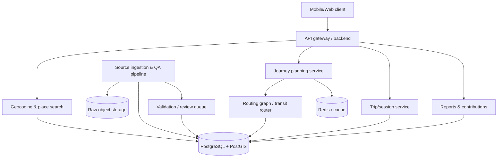

> **SUPERSEDED (in part) — see note.** This document is retained as a research-draft record. The technology choices in its §2 ("Suggested stack — evaluate, not final": Flutter-or-React-Native client, OTP/GraphHopper/Valhalla evaluation) are **no longer open options**; they were decided in the approved baseline stack. The authoritative technology decisions are: `docs/architecture/00_EXECUTIVE_SUMMARY_AND_DECISIONS.md` (decision table), `docs/architecture/07_TECH_STACK.md`, and the ADRs in `docs/adr/`. The §3 canonical domain model and the testing/AI-boundary principles in this document remain valid reference material and are consistent with the newer documents.

# Technical Architecture and Application Behaviour

**Design target:** maintainable, auditable, data-driven multimodal routing system. This is a recommended architecture for discussion; technology choices are not locked.

## 1. Architecture overview

## 2. Suggested stack (evaluate, not final)

- Client: Flutter or React Native for cross-platform mobile; optional web client using React/Next.js. Decide after prototype and offline/accessibility testing.
- API: Python FastAPI or another typed backend; REST first for clear mobile contracts.
- Database: PostgreSQL + PostGIS for canonical route, stop, POI and geometry data.
- Routing engine: evaluate OpenTripPlanner (transit-focused GTFS routing), GraphHopper/Valhalla (pedestrian/network routing), and custom multimodal graph. Avoid writing a full routing engine prematurely. Static route graph may be custom for MVP if scope is limited.
- Cache: Redis for route-query cache, place search and temporary session state.
- Raw source archive: object storage with immutable source snapshots, metadata and checksums.
- Observability: structured logs, metrics, tracing, error reporting; avoid logging precise user journeys by default.
- CI: data validation tests, API tests, routing regression cases, localization tests and client tests.

## 3. Domain model (canonical data)

### Transport agency/operator
- id, name, aliases, mode, source, contact/website when appropriate.

### Route
- stable internal ID, public route reference/number, name, mode, agency/operator, aliases, source and status.

### Route variant / service pattern
- route_id, variant_id, direction, origin, destination, ordered stop pattern, service type, partial/limited-stop metadata, shape, validity, source and confidence.
- Do not collapse variants just because route number matches.

### Stop / station / platform
- ID, name, aliases, coordinate, mode, stop type, access points, stand/bay/platform where known, direction served, landmark, source, verification, confidence, accessibility attributes (known/unknown).

### Route-stop sequence
- variant ID, stop ID, sequence number, boarding/alighting eligibility if known, source evidence.

### Shape / pedestrian graph
- route geometry; pedestrian links/nodes; crossings/path restrictions where mapped; provenance and version.

### Transfer connection
- from stop/platform/stand to next; pedestrian path geometry; length; estimated duration; crossing/stairs/access attributes; source/verification; confidence.

### Destination / POI / entrance
- entity, category, names/aliases, coordinates, access points/entrances, public access notes and source.

### Fare record
- route/variant/service class, amount/currency, effective date, source and confidence. Fare must not be treated as current without validity logic.

### Source record / verification / report
- source type/URL/file, captured date, checksum, licence, extraction version, record mapping, verification event, issue report, reviewer and audit history.

## 4. Data pipeline

1. Discover and capture source (URL/file/API/field observation).
2. Archive raw original plus source metadata, checksum, retrieval timestamp and licence note.
3. Parse/extract (GTFS, OSM, GIS REST, PDFs, CSV, manual field notes).
4. Normalize names, identifiers, coordinates, route refs, language aliases and units.
5. Match entities across sources with explainable candidate scores; ambiguous matching goes to review.
6. Validate schema, geometry, route sequence, duplicate stops, route continuity, transfer distance, missing direction, variant conflicts and source freshness.
7. QA queue and field review for critical facts.
8. Publish canonical version and generate graph/routing artifacts.
9. Run regression tests on curated journeys.
10. Monitor coverage and feedback; version changes and roll back if needed.

## 5. Route-planning algorithm requirements

### Inputs
- Origin coordinate/place entity; destination entity/entrance.
- Modes allowed.
- Max walking distance, transfer preference, optional accessibility preferences.
- Network snapshot/version and data-confidence thresholds.
- Departure time only if schedule-aware routing is later supported.

### Candidate generation
- Snap origin/destination to pedestrian network and candidate stops within a configurable walk radius.
- Identify feasible transit variants passing through candidate boarding/alighting stops.
- Generate direct and multi-leg candidates using explicit transfer connections.
- Apply transfer/walking limits and network coverage constraints.
- Ensure route variant stop sequence supports the required boarding-to-alighting segment.
- Include rail only where station order and service pattern are validated.

### Ranking
Use multi-objective ranking or Pareto filtering across estimated duration, walk distance, transfers, verified fare and complexity/confidence. Do not make “fastest” exact when time estimates are weak. Avoid duplicate candidates and excessive alternatives.

### Time estimate
MVP estimates may be based on walking speed, route distance and documented average speed assumptions. Ride time should have uncertainty/range. If service schedule and operation are not verified, label “network-based; service availability not verified.” Do not calculate departure/arrival predictions from route geometry alone.

### Output
Structured itinerary with legs, steps, stops, direction, distances, estimates, fare fields (nullable), confidence, sources/freshness, map geometry, caveats and recovery context.

## 6. Instruction generation

Use deterministic templates and validated structured facts for critical instructions. AI can simplify/explain the instruction, translate or answer a question grounded in the itinerary, but must not create factual route details.

**Grounding contract:** AI receives only the current route/leg facts, approved aliases, verified landmarks, confidence and caveats. It must return references to source fact IDs or be rejected for critical actions. If data is missing, say it is unknown.

Examples of template facts:
- Walk distance/time and path instructions.
- Boarding stop, route and direction.
- Alighting stop and number of stops if sequence is verified.
- Transfer connector.
- Final entrance.

## 7. API surface (illustrative)

- `GET /places/search?q=&lang=&near=`
- `GET /places/{id}`
- `POST /journeys/plan` (origin, destination, preferences, mode set)
- `GET /journeys/{plan_id}`
- `POST /journeys/{plan_id}/sessions` (start active session; optional)
- `PATCH /journeys/sessions/{id}` (progress confirmation; avoid unnecessary location history)
- `POST /reports` (data correction)
- `GET /routes/{id}` / `GET /stops/{id}`
- `GET /coverage` (coverage status)
- `GET /data-version` (current network snapshot)

API contracts must include schema version, nullable unknown fields, source/confidence metadata, error codes, localization and caching semantics.

## 8. Client state and journey state machine

Possible states: Planning → Results → Overview → Active (Walk to board) → Active (Ride) → Active (Transfer walk) → Active (Final walk) → Completed. Other states: Paused, Replanning, Offline, Needs confirmation, Cancelled.

Transitions must be driven by user confirmation and/or GPS with accuracy and dwell safeguards. Avoid silently switching critical states from noisy location data.

## 9. Offline design

- Download/cache selected itinerary and relevant stops/routes/variants.
- Local store supports manual progress and instruction access.
- Cache expiry and data-version metadata.
- Map caching is subject to map provider licence.
- Offline feedback queue requires explicit consent.
- No active live data claims offline.

## 10. Privacy, security and safety

- Basic planning should not require an account.
- Ask location permission contextually; manual search remains available.
- Do not retain detailed journey history unless user opts in and purpose is clear.
- Active location sharing requires explicit start, expiry, access control and stop control.
- Encrypt traffic and sensitive stored data; restrict access; secure secrets.
- Do not log precise coordinates, search terms or trip details unless required and appropriately protected.
- Data deletion and retention policy.
- Moderation for reports/photos; remove faces/vehicle plates where practical; do not publish sensitive observations without review.
- AI instruction generation must be grounded and audited.
- Accessibility claims require evidence.

## 11. Quality and testing

### Data tests
- Geometry validity, route continuity, stop sequence, duplicate stops, alias uniqueness where possible, transfer walking distance, missing fields, stale source.

### Routing tests
- Curated origin/destination cases with expected valid alternatives.
- Route-variant correctness.
- Transfer correctness and walk path.
- No route fabricated when coverage missing.
- Cost/walk/transfer ranking tests.

### UX tests
- Can user identify boarding stop, route/direction, alighting stop, transfer and final entrance?
- Language search and instruction comprehension.
- No network and permission denied.
- Accessibility and screen-reader checks.

### Performance
- Search latency and planning latency targets to set after pilot load testing; aim for responsive interaction, but avoid hard promises before measurement.

## 12. AI features: safe and appropriate scope

- Explain itinerary in simple language.
- Translate reviewed instructions.
- Answer “why this route?” based on structured criteria.
- Contextual help for route/step.
- Summarize verified landmarks and known data gaps.
- Report classification/triage assistance for submitted corrections.

Not allowed as sole authority: route generation, stop identity, fares, service operation, current traffic, safety assurances, accessibility assurances or alighting alerts.

## 13. Architecture decisions to record later

- Mobile framework.
- Router (OTP vs custom graph vs hybrid).
- Geocoding/search provider and licence/caching.
- Map renderer/tile source.
- Offline storage technology.
- Auth model and optional accounts.
- AI provider and groundedness controls.
- Hosting and deployment region/cost.
- Contribution moderation and verification staffing.
